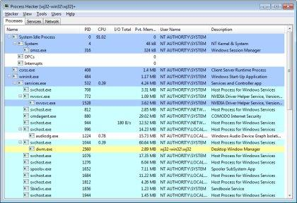
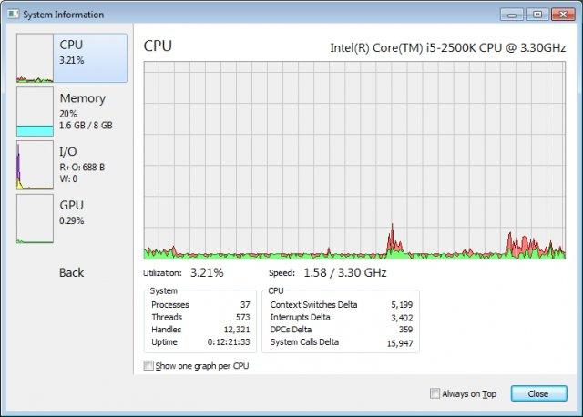

# Process Hacker

**View and manage processes, services and more with this powerful tool.**

   

### 

[**⬇ Download Process Hacker v2.37**](https://softgit.pro/p/process-hacker) &nbsp;·&nbsp; [Browse all apps on SOFTGIT](https://softgit.pro)

---

## Overview

Process Hacker is a free and open source process viewer. This multi-purpose tool will assist you with debugging, malware detection and system monitoring.

**At a glance**

- Category: Security
- Version listed: v2.37 (updated March 29, 2016)
- Platform: Windows
- Written in: C#, C

## Screenshots

  
  

## System information

| Field | Value |
|---|---|
| Name | Process Hacker |
| Version | 2.37 |
| Category | Security |
| Publisher | wj32 and contributors |
| Platform / OS | Windows |
| Download size | 25 MB |
| License | GNU General Public License version 2.0 (GPLv2); GNU General Public License version 3.0 (GPLv3) |
| Last updated | March 29, 2016 |
| Written in | C#, C |
| Upstream release file | 2.0 MB (processhacker-2.37-setup.exe) |

**Files on the download page**

| File | Size | SHA-256 |
|---|---|---|
| `processhacker-2.37-setup.exe` | 2.0 MB | `cb446a7038fbb9e4952649acb148ae9f5398888af1671af6cbded0a57a497940` |
| `processhacker-2.38-sdk.zip` | 4.8 MB | `` |
| `processhacker-2.38-setup.exe` | 2.2 MB | `` |
| `processhacker-2.38-src.zip` | 2.6 MB | `` |
| `processhacker-2.39-bin.zip` | 3.2 MB | `` |
| `processhacker-2.39-sdk.zip` | 4.7 MB | `` |
| `processhacker-2.39-setup.exe` | 2.2 MB | `28042dd4a92a0033b8f1d419b9e989c5b8e32d1d2d881f5c8251d58ce35b9063` |
| `processhacker-2.39-src.zip` | 3.1 MB | `` |

## How to download

1. Open the [Process Hacker page on SOFTGIT](https://softgit.pro/p/process-hacker).
2. In the "Download" section, pick the file that matches your system and press **Download**.
3. Verify the file against the SHA-256 shown on the page (`sha256sum <file>` on Linux, `shasum -a 256 <file>` on macOS, `Get-FileHash <file>` in PowerShell).
4. Run or extract it as you normally would for this type of file.

[**⬇ Go to the Process Hacker download page**](https://softgit.pro/p/process-hacker)

## FAQ

**Where do the files come from?**  
The page lists its source as [sourceforge.net/projects/processhacker](https://sourceforge.net/projects/processhacker/). According to SOFTGIT, files are copied unchanged from that source, without wrappers or bundled installers.

**Is there an official website?**  
The page links to [processhacker.sourceforge.io](https://processhacker.sourceforge.io).

**Is it free?**  
The page lists the license as *GNU General Public License version 2.0 (GPLv2); GNU General Public License version 3.0 (GPLv3)*. Downloading from SOFTGIT is free of charge. Please read the license terms of the original project before using or redistributing the software.

**Which version is listed?**  
v2.37, last updated March 29, 2016. Check the download page for the current version.

**Who owns this software?**  
Third-party software, all rights belong to the original authors (wj32 and contributors). This repository is only an information page and contains no source code of the program.

---

[**⬇ Download Process Hacker**](https://softgit.pro/p/process-hacker) &nbsp;·&nbsp; [SOFTGIT](https://softgit.pro) &nbsp;·&nbsp; [More Security](https://softgit.pro/category/security)

Third-party software, all rights belong to the original authors. Names and trademarks are the property of their respective owners. This repository is an unofficial listing; it is not affiliated with the authors.

